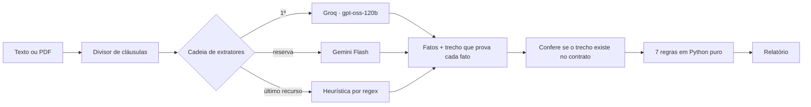

# Lupa do Aluguel

[](https://github.com/SirDann-sys/lupa-do-aluguel/actions/workflows/ci.yml)
[](https://github.com/SirDann-sys/lupa-do-aluguel/actions/workflows/avaliacao.yml)

**▶ [Usar agora](https://sirdann-sys.github.io/lupa-do-aluguel/)** · cole um contrato de aluguel (ou envie o PDF) e veja quais
cláusulas violam a Lei do Inquilinato, com o trecho, o artigo e o que pedir ao proprietário.

> **Aviso:** programa de demonstração, feito para portfólio. Pode errar e não substitui um advogado.
> Não use o resultado para decisões reais.

## A ideia central: a IA lê, o código decide

Pedir a um LLM "essa cláusula é abusiva?" dá respostas que mudam de uma chamada para outra e que ninguém
consegue auditar. Aqui o trabalho é dividido:



1. **O LLM só extrai fatos**, num schema Pydantic com saída por JSON Schema em modo estrito: tipo de garantia,
   meses de caução, prazo de reajuste, se o inquilino paga despesas extraordinárias… Nenhum campo é um juízo.
2. **Cada fato vem com o trecho literal que o prova.** Se o trecho não estiver no contrato (tolerando caixa,
   acentos, espaços e reticências), o fato é descartado antes de chegar às regras. É a barreira contra alucinação,
   e o relatório conta quantos fatos foram descartados.
3. **As 7 regras são funções puras** (`backend/app/dominio/regras.py`), testadas sem IA. Algumas só fazem sentido
   no contrato inteiro: a caução vem em reais numa cláusula e o aluguel em outra; o fiador numa cláusula e o
   seguro-fiança em outra.

## As 7 regras

| # | Regra | Base legal |
|---|---|---|
| 1 | Caução acima de 3 meses de aluguel | Lei 8.245/91, art. 38, §2º |
| 2 | Mais de uma garantia ao mesmo tempo | Lei 8.245/91, art. 37, parágrafo único |
| 3 | Despesas extraordinárias de condomínio cobradas do inquilino | Lei 8.245/91, art. 22, X |
| 4 | Taxa de administração ou intermediação cobrada do inquilino | Lei 8.245/91, art. 22, VII |
| 5 | Pintura nova obrigatória, mesmo sem necessidade | Lei 8.245/91, art. 23, III |
| 6 | Reajuste em prazo menor que 12 meses | Lei 10.192/01, art. 2º, §1º |
| 7 | Cobrança antecipada de vários meses de aluguel | Lei 8.245/91, art. 20 e art. 38, §2º |

## Quanto acerta

`avaliacao/rodar.py` passa cada contrato fictício pelo mesmo serviço da API e compara com o gabarito. São dois
conjuntos:

- **desenvolvimento** (9 contratos): usados para escrever o extrator heurístico;
- **teste cego** (16 contratos): escritos depois, com redações novas, **sem nenhum ajuste posterior**.

A avaliação com IA roda toda segunda no GitHub Actions e publica o resultado
[na página](https://sirdann-sys.github.io/lupa-do-aluguel/#como-funciona), do jeito que sair. Última medição (12/11/2026):

| Extrator | Conjunto | Contratos exatos | Precisão | Recall |
|---|---|---|---|---|
| **Groq · gpt-oss-120b** | desenvolvimento | 9/9 | 100% | 100% |
| **Groq · gpt-oss-120b** | **teste cego** | **16/16** | 100% | 100% |
| Linha de base: heurística, sem IA | desenvolvimento | 9/9 | 100% | 100% |
| Linha de base: heurística, sem IA | teste cego | 10/16 | 100% | 43% |

A linha de base mostra o que a IA acrescenta: regex não pega "honorários de corretagem", "chamadas de capital
para benfeitorias", "pintará na cor branca ainda que em bom estado" ou "quitará os três primeiros meses"; o LLM pegou
todos. A heurística só responde quando a IA está fora do ar, e o relatório avisa o usuário quando isso acontece.
Uma limitação conhecida dela, mantida de propósito para não contaminar o teste cego: não reconhece "LOCATÁRIA"
no feminino. 25 contratos fictícios ainda são uma amostra pequena; o número vale como sinal, não como garantia.

## Engenharia

| | |
|---|---|
| **API** | FastAPI com fábrica de app e injeção de dependências (os testes trocam a IA por um extrator fixo, sem monkeypatch). Erros padronizados `{erro: {codigo, mensagem}}`, `X-Request-Id`, logs em JSON. |
| **Resiliência** | Cadeia Groq → Gemini → heurística, com retry exponencial, respeito ao `Retry-After` e corte quando a espera não compensa. A análise quase nunca fica sem resposta, e o relatório diz quem respondeu. |
| **Um cliente para dois provedores** | Groq e Gemini falam o formato `/chat/completions`; um adaptador `httpx` atende os dois, sem SDK. O conversor de schema gera o modo estrito (tudo `required`, `additionalProperties: false`, sem `$ref`). |
| **Privacidade (LGPD)** | CPF, RG, CNPJ, e-mail, telefone e CEP são mascarados na entrada, antes da IA, do cache e da resposta. Consentimento explícito antes do envio e [aviso de privacidade](https://sirdann-sys.github.io/lupa-do-aluguel/privacidade.html) com a transferência ao Groq (EUA). O texto nunca vai para disco: cache só em memória (até 24 h). O banco guarda métricas sem conteúdo, e nenhum log grava IP. Um teste garante que nenhuma coluna guarda texto. |
| **Banco** | SQLAlchemy 2.0 tipado + Alembic. Um teste compara a migração com os modelos (sem divergência) e roda no CI contra PostgreSQL real. Em produção, PostgreSQL no Neon. |
| **Proteção da cota grátis** | Limite por IP (janela deslizante) e limite diário global, com `429` e `Retry-After`. |
| **Qualidade** | `mypy --strict`, Ruff, 130+ testes, cobertura acima de 95%. |
| **Entrega** | Imagem Docker multi-stage, sem root, com healthcheck. O CI sobe o container e faz uma análise de verdade nele. O Render só publica com o CI verde. |
| **Front-end** | HTML, CSS e JS sem framework no GitHub Pages, com CSP. Conteúdo da API entra só por `textContent`. Acessível por teclado, tema claro e escuro. |

## Rodar localmente

```bash
python -m venv .venv
.venv\Scripts\activate            # Linux/macOS: source .venv/bin/activate
pip install -r requirements-dev.txt

pytest --cov                      # testes
python avaliacao/rodar.py         # avaliação com o extrator heurístico (sem chave)

cd backend
uvicorn app.main:app_producao --factory --reload     # API em http://127.0.0.1:8000/docs
```

Sem chaves, a API usa só a heurística. Para usar IA, copie `.env.example` para `.env` e preencha
`LUPA_GROQ_API_KEY` (grátis em console.groq.com) e, se quiser a reserva, `LUPA_GEMINI_API_KEY`.

## Estrutura

```
backend/app/
  dominio/      modelos (fatos, achados), as 7 regras, validação de evidências
  entrada/      divisor de cláusulas, leitura de PDF
  llm/          adaptador OpenAI-compatível, conversor de schema, prompt, heurística, cadeia
  servicos/     orquestração da análise, cache, limites de uso
  db/           modelos SQLAlchemy e repositório de métricas
  api/          rotas FastAPI
backend/migrations/   Alembic
backend/tests/        pytest
avaliacao/            contratos fictícios, gabarito e o avaliador
frontend/             a página publicada no GitHub Pages
```

## Licença

Ver [`LICENSE`](./LICENSE). Todos os contratos do repositório são fictícios.
